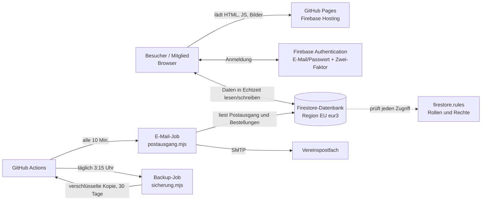

# Vereinsportal BSG Medizin Dessau e.V.

Vereinswebsite mit Mitglieder-, Trainer- und Verwaltungsbereich – gebaut nach dem Emmoke-System
(React 19 · TypeScript · Vite · Tailwind 4). Den vollständigen Plan mit Funktionsübersicht, Rollen und Zeitplan
enthält [BAUPLAN.md](BAUPLAN.md).

## Starten

```bash
npm install
npm run dev        # http://localhost:5173
npm test           # Tests der Kernlogik (Tabelle, Statistik, Rechte, IBAN, Kalender …)
npm run build      # erzeugt dist/ inkl. 404.html, sitemap.xml, robots.txt
```

Beim ersten Start werden Beispieldaten geladen. Demo-Zugänge (unter `/login` anklickbar):

| Rolle | E-Mail | Passwort |
|---|---|---|
| Admin | admin@verein.de | admin123 |
| Vorstand | vorstand@verein.de | vorstand123 |
| Trainer (1. Herren, F-Junioren) | trainer@verein.de | trainer123 |
| Redakteur | redaktion@verein.de | redaktion123 |
| Mitglied | mitglied@verein.de | mitglied123 |

> Vor dem Livegang im Admin unter „Benutzer & Rollen“ löschen bzw. ändern.

## Veröffentlichen

- **GitHub Pages:** Der Workflow `.github/workflows/pages.yml` baut bei jedem Push auf `main` und veröffentlicht unter
  `https://<konto>.github.io/<repo>/` (Pages in den Repo-Einstellungen auf „GitHub Actions“ stellen).
- **Firebase Hosting / eigene Domain:** siehe Abschnitt „Hosting & Domain“.

## Testbetrieb und Veröffentlichung

Bis alle Angaben erledigt sind, läuft die Webseite im **Testbetrieb**: Gäste sehen nur eine „Bald online“-Seite mit
Anmeldung, Impressum und Datenschutz (für Suchmaschinen gesperrt). Angemeldete Personen (Vorstand, Trainer, Mitglieder)
sehen die komplette Seite mit einem gelben Hinweisbalken. Die Sperre gilt auch in der Datenbank: `firestore.rules`
(`sichtbar()`) gibt Gästen keine Inhalte heraus, solange `meta/verein.veroeffentlicht` nicht `true` ist.

**Veröffentlichen:** Verwaltung → Webseite → „Veröffentlichung“. Die Checkliste zeigt, was noch fehlt (Impressum,
Datenschutzerklärung, Vorstand, sichtbare Abteilungen, keine Beispiel-Inhalte, Shop-Texte, Bankverbindung). Mit dem
Schalter „Webseite öffentlich“ ist die Seite sofort für alle sichtbar; zurück in den Testbetrieb geht es genauso.

## Betrieb und Eigentum (Empfehlung)

Der Verein bleibt jederzeit Eigentümer von Webseite, Daten und Zugängen; der Entwickler bekommt nur die nötigen Rechte.

```
Verein
├── Google-Konto des Vereins (z. B. admin@bsg-medizin-dessau.de)
│   └── Firebase-Projekt bsg-medizin-dessau: Hosting, Firestore, Authentication, Storage
├── IONOS (Webhosting Plus): Domain bsg-medizin-dessau.de, SSL, Postfächer info@, vorstand@, ggf. shop@
├── GitHub (Organisation des Vereins): Quellcode, automatische Veröffentlichung, E-Mail- und Backup-Jobs
└── Entwickler: Administrator-/Bearbeiterrechte im Firebase-Projekt und im GitHub-Repository
```

| Was | Eigentümer | Entwickler |
| --- | --- | --- |
| Google-Konto, Firebase-Projekt | Verein (Rolle „Inhaber“) | Rolle „Bearbeiter“ bzw. „Firebase-Administrator“ |
| Domain, E-Mail-Konten (IONOS) | Verein (Vertragspartner) | kein Zugang nötig, ggf. DNS-Zugriff |
| GitHub-Repository | Organisation des Vereins | Mitglied mit Schreibrecht |
| Admin-Zugang im Vereinsportal | Vorstand (mind. 2 Administratoren mit Zwei-Faktor) | eigener Zugang, jederzeit sperrbar |
| Secrets (Dienstkonto, Backup-Passwort, SMTP) | im GitHub des Vereins, Backup-Passwort beim Vorstand | setzt sie ein, bewahrt keine Kopie auf |

**Übergabe an den Verein (einmalig):**
1. Google-Konto des Vereins anlegen (am besten mit einer Vereinsadresse) und mit Zwei-Faktor schützen.
2. Firebase-Konsole → Projekteinstellungen → Nutzer und Berechtigungen: das Vereinskonto als **Inhaber** hinzufügen;
   das Entwicklerkonto danach auf „Bearbeiter“ zurückstufen.
3. GitHub: Organisation für den Verein anlegen und das Repository dorthin übertragen (Settings → Transfer);
   Entwickler als Mitglied einladen. Danach die Secrets dort neu hinterlegen.
4. IONOS-Vertrag (Domain, Postfächer) auf den Verein abschließen.
5. Im Portal: mindestens zwei Vorstandsmitglieder als Administrator mit Zwei-Faktor-Anmeldung.

Vorteile: keine Abhängigkeit vom Entwickler, Wechsel jederzeit möglich, klare Verantwortung im Datenschutz,
geringe Kosten (Firebase im kostenlosen Spark-Tarif, IONOS Webhosting Plus ca. 132 €/Jahr), kein eigener Server.

## So arbeitet die Webseite

Die Webseite ist eine **Single-Page-App**: Der Browser lädt einmal `index.html` und das JavaScript; danach wechselt die
App die Seiten selbst (eigener kleiner Router, `src/router.tsx`), ohne neu zu laden. Es gibt **keinen eigenen Server** –
die Dateien liegen statisch auf GitHub Pages bzw. Firebase Hosting, alle Daten kommen direkt aus **Google Firebase**.



**Ablauf beim Öffnen einer Seite**

1. `src/main.tsx` startet die App. Mit Firebase (Normalbetrieb) ruft es `cloudStarten()` aus `daten/cloud.ts` auf.
2. `cloud.ts` abonniert die Firestore-Sammlungen **je nach Anmeldung und Rechten**: Gäste bekommen nur Öffentliches
   (veröffentlichte News, öffentliche Termine, Mannschaften, Spiele …), angemeldete Benutzer zusätzlich das, was ihre Rolle
   sehen darf. Änderungen anderer Nutzer kommen sofort an (Echtzeit).
3. Alles landet im zentralen Datenspeicher `daten/speicher.ts`. Jede Seite liest dort mit `useDaten()` und zeigt sich
   automatisch neu, wenn sich Daten ändern.
4. Die öffentliche Seite filtert vorher ausgeblendete Sportarten/Abteilungen heraus (`oeffentlich/daten.ts`).
5. Speichert jemand etwas (z. B. ein Ergebnis), ändert `speicher.ts` den Stand, schreibt einen Protokolleintrag und
   `cloud.ts` überträgt **nur die geänderten Einträge** an Firestore. Die Sicherheitsregeln lehnen alles ab, wofür die Rolle
   kein Recht hat.
6. Große Bilder/Dateien (über 20 KB) werden als eigenes Dokument in `medien` abgelegt und im Text nur als `medien:<id>`
   gespeichert; die Seite lädt sie beim Anzeigen nach. Eigene Bildpfade werden an die jeweilige Adresse angepasst
   (`daten/pfade.ts`), damit sie auf GitHub Pages, Firebase Hosting und der eigenen Domain funktionieren.

**Demo-Modus:** Mit `?demo` an der Adresse läuft alles nur im Browser mit Beispieldaten (localStorage) – ohne Firebase,
gut zum Ausprobieren und für Vorführungen. `?demo=aus` beendet ihn.

## Webplan (alle Seiten)

### Öffentlicher Bereich (für alle)

| Bereich | Adresse | Inhalt |
| --- | --- | --- |
| Startseite | `/` | Begrüßung mit Titelfoto, Kennzahlen, Vorschau Spiele/Termine, Glückwünsche, Neuigkeiten, Sponsoren |
| Verein | `/verein`, `/verein/vorstand`, `/verein/geschichte`, `/verein/satzung`, `/verein/trainingszeiten`, `/verein/sportstaetten` | Über uns, Vorstand, Chronik, Satzung, Trainingszeiten, Hallen |
| Abteilungen | `/mannschaften`, `/mannschaften/<id>`, `/mannschaften/<id>/<reiter>`, `/mannschaften/trainer` | Sportarten und Teams mit Kader, Spielen, Tabelle, Training; alle Trainer |
| Spielbetrieb | `/spielbetrieb/spielplan`, `…/ergebnisse`, `…/tabellen`, `…/statistik`, `…/archiv`, `/spiele/<id>` | Spielplan, Ergebnisse, Tabellen, Torschützen, Archiv, Spielbericht |
| Inhalte | `/news`, `/news/<id>`, `/veranstaltungen`, `/galerie`, `/galerie/<id>`, `/sponsoren` | Neuigkeiten, Termine (mit Kalenderexport), Fotos/Videos, Partner |
| Fanshop | `/shop`, `/shop/<id>`, `/warenkorb`, `/kasse`, `/agb`, `/widerruf` | Artikel, Warenkorb, Bestellung, Zahlung, AGB, Widerrufsbelehrung |
| Mitmachen | `/mitglied-werden`, `/kontakt`, `/registrieren`, `/login`, `/gaestebuch` | Online-Antrag mit SEPA, Kontaktformular, Zugang beantragen, Anmeldung, Gästebuch |
| Sonstiges | `/downloads`, `/links`, `/vereinsheim`, `/besucherstatistik` | Dokumente, Links, Vereinsheim, anonyme Besucherzahlen |
| Rechtliches | `/impressum`, `/datenschutz`, Fußzeile „Cookie-Einstellungen“ | Impressum, Datenschutzerklärung, Einwilligung |
| Einrichtung | `/einrichtung` | einmalige Ersteinrichtung der Datenbank (nur freigegebenes Admin-Konto) |

### Portal (nach Anmeldung, Menü je nach Rolle und Rechten)

| Gruppe | Adresse | Seite | nötiges Recht |
| --- | --- | --- | --- |
| Mein Verein | `/intern` | Übersicht mit Spielzusagen | `intern.zugang` |
| | `/intern/mitteilungen`, `/intern/termine`, `/intern/dokumente` | interne Nachrichten, Termine, Dokumente | `intern.zugang` |
| | `/intern/profil` | Profil, Passwort, Zwei-Faktor, eigene Daten, Löschantrag | `intern.zugang` |
| Trainer & Team | `/trainer`, `/trainer/kader`, `/trainer/training`, `/trainer/spiele`, `/trainer/medien` | eigene Teams, Spielerliste, Training & Anwesenheit, Spieltage, Fotos & Berichte | `trainer.zugang` |
| Verwaltung | `/admin` | Dashboard mit Statistik und Aufgaben | `admin.zugang` |
| | `/admin/finanzen` | Kasse, Rechnungen, Angebote, Spendenbescheinigungen, Beitragslauf | `finanzen.verwalten` |
| | `/admin/shop` | Fanshop: Bestellungen, Artikel, Einstellungen | `shop.verwalten` |
| | `/admin/email` | Rundschreiben, Vorlagen, Postausgang | `email.senden` |
| | `/admin/werbung` | Werbung & Social-Media-Bilder | `werbung.erstellen` |
| | `/admin/besucher`, `/admin/protokoll` | Besucherstatistik, Änderungsprotokoll | `statistik.sehen` |
| | `/admin/datenschutz` | DSGVO-Checkliste, Löschkonzept, Auskunft, Löschung, Auftragsverarbeiter, Sicherheit | `verein.verwalten` |
| | `/admin/logo`, `/admin/verein`, `/admin/webseite` | Vereinslogo, Vereinsdaten/Beiträge, Webseite & Domain | `verein.verwalten` |
| | `/admin/news`, `/admin/gaestebuch` | News, Gästebuch-Freigabe | `news.verwalten` |
| | `/admin/termine`, `/admin/medien`, `/admin/sponsoren` | Veranstaltungen, Galerie & Videos, Sponsoren | `termine.` / `medien.` / `sponsoren.verwalten` |
| | `/admin/mannschaften` | Abteilungen & Teams (ein-/ausblenden) | `mannschaften.verwalten` |
| | `/admin/spiele`, `/admin/gegner` | Spiele & Tabellen, Gegnervereine mit Wappen | `spiele.verwalten` |
| | `/admin/mitglieder` | Mitgliederliste, Excel-Export | `mitglieder.verwalten` |
| | `/admin/formulare` | Mitgliedsanträge und Kontaktanfragen | `formulare.verwalten` |
| | `/admin/dokumente` | Dokumente hochladen | `dokumente.verwalten` |
| | `/admin/benutzer`, `/admin/rechte` | Benutzer & Rollen, Registrierungen freischalten, Rechte-Matrix | `benutzer.` / `rechte.verwalten` |
| | `/admin/sicherung` | Sicherung herunterladen/einspielen | `sicherung.verwalten` |

**Rollen:** Administrator (alles), Vorstand, Trainer (nur eigene Teams), Redakteur (News, Termine, Galerie, Werbung),
Mitglied (Mitgliederbereich). Welche Rolle was darf, ist im Portal unter „Rechteverwaltung“ einstellbar und wird in
`meta/verein.rechte` gespeichert – die Firestore-Regeln lesen genau diese Liste.

## Bauteile (Dateien)

```
src/
  main.tsx, App.tsx      Start, Vereinsfarben, Zuordnung Adresse → Seite (öffentlich oder Portal)
  router.tsx, seo.ts     eigener Router (Basis-Pfad je Hosting), Seitentitel/Beschreibung für Suchmaschinen
  stil.css               Tailwind 4, Vereinsfarben als Variablen, Hintergründe und Effekte
  daten/
    typen.ts             Datenmodell aller Sammlungen (Verein, Mannschaft, Spiel, Mitglied, Bestellung …)
    speicher.ts          zentraler Datenspeicher (lesen, speichern, Protokoll, Browser-Zwischenspeicher, Sicherungen)
    cloud.ts             Firebase-Anbindung: Echtzeit-Abos nach Rechten, Schreiben als Differenz, Medien auslagern
    firebase.ts          Firebase-Konfiguration, App Check, Storage, Konto anlegen, Fehlermeldungen auf Deutsch
    modus.ts             Firebase- oder Demo-Betrieb
    anmeldung.ts         Login, Abmelden, Passwort, Passwortrichtlinie, Registrierung, Zwei-Faktor (TOTP)
    rechte.ts            Rollen, Rechte, Standardverteilung, Rechte-Migration
    auswertung.ts        Datum, Tabellenrechnung, Bilanz, Spielerstatistik, Geburtstage, Kalender (ICS), IBAN-Prüfung
    finanzen.ts          Nummernkreise, Kontostand, Jahresauswertung nach Steuerbereichen, Beitragslauf, GiroCode, Betrag in Worten
    pdf.ts               Rechnungen, Angebote, Spendenbescheinigungen als PDF (Briefkopf, Logo, GiroCode)
    shop.ts              Warenkorb, Versand, Bestellnummer, PayPal-/Stripe-Link, Rechnung aus Bestellung
    excel.ts             echter .xlsx-Export ohne Zusatzbibliothek
    rechtstexte.ts       Mustertexte Datenschutzerklärung, AGB, Widerrufsbelehrung
    beispiel.ts          Startdaten der BSG (von bsg-medizin.de) und Demo-Beispiele
    pfade.ts, bilder.ts  Bildpfade je Hosting, Bilder im Browser verkleinern
    sha256.ts            Hash für Medien-IDs und Demo-Passwörter
  oeffentlich/           öffentliche Seiten: Layout (Menü, Fußzeile), Start, Verein, Mannschaften, Spielbetrieb,
                         Inhalte (News, Termine, Galerie, Sponsoren, Login), Formulare (Antrag, Kontakt, Registrierung),
                         Shop, Extras (Archiv, Vereinsheim, Links, Gästebuch, Statistik), Einwilligung (Cookie-Hinweis),
                         SportSzene/Teile (Bilder, Wappen, Spielzeilen, Tabellen)
  portal/                Portal (Menü + Rechteprüfung + Auto-Abmeldung), Intern, Trainer, SpielEditor, AdminInhalte,
                         AdminVerein, AdminSystem, AdminWeb, Finanzen, ShopVerwaltung, Email, Werbung, Besucher, Logo,
                         Datenschutz, ZweiFaktor, Einrichtung
  effekte/               Bewegung (GSAP, Lenis, Zähler, Licht), ShapeWaves-Hintergrund
  ui/bausteine.tsx       Karte, Knopf, Feld, Dialog, Reiter, Kachel, Bildauswahl, Hinweise
public/                  wappen.png, bsg/ (Bilder und PDFs des Vereins), fotos/ (lizenzfreie Fotos), gegner/ (Wappen)
werkzeuge/               nach-build.mjs (CSP, 404, Sitemap), einrichten.ts (Ersteinrichtung), postausgang.mjs (E-Mails),
                         sicherung.mjs / entschluesseln.mjs (Backups), sicherheit-einrichten.mjs (Zwei-Faktor, Passwortregeln)
tests/                   Tests der Kernlogik (Tabelle, Rechte, IBAN, Kalender, Finanzen, Shop, Excel, Bildpfade)
firestore.rules          Sicherheitsregeln der Datenbank
storage.rules            Sicherheitsregeln für Firebase Storage (optional)
firebase.json            Firebase Hosting (Weiterleitung, Sicherheits-Header, Cache) und Regeln
.github/workflows/       pages.yml, firebase.yml, postausgang.yml, sicherung.yml, sicherheit.yml
```

## Wie und wo gebaut wird

| Schritt | Wo | Was passiert |
| --- | --- | --- |
| Entwickeln | lokal, `npm run dev` | Vite-Entwicklungsserver auf `http://localhost:5173` |
| Prüfen | lokal und bei jedem Push | `npm test` (Logik-Tests), `tsc --noEmit` (Typprüfung) |
| Bauen | `npm run build` | TypeScript prüfen → Vite erzeugt `dist/` → `werkzeuge/nach-build.mjs` fügt Sicherheitsrichtlinie (CSP), `404.html`, `sitemap.xml`, `robots.txt` hinzu |
| Code speichern | GitHub `Emmoke/bsg-medizin-dessau`, Zweig `main` | jede Änderung als Commit |
| Veröffentlichen | GitHub Actions `pages.yml` | baut mit `BASIS=/bsg-medizin-dessau/` → https://emmoke.github.io/bsg-medizin-dessau/ |
| | GitHub Actions `firebase.yml` (mit Secret `FIREBASE_DIENSTKONTO`) oder `firebase deploy` | baut mit `BASIS=/` → https://bsg-medizin-dessau.web.app (später www.bsg-medizin-dessau.de) und spielt die Sicherheitsregeln ein |

## Wo die Angaben gespeichert werden

### Firestore-Datenbank (Projekt `bsg-medizin-dessau`, Region EU)

Jede Sammlung ist eine Firestore-Collection, jeder Eintrag ein Dokument (Dokument-ID = `id`). Daten werden
verschlüsselt übertragen (HTTPS) und von Google verschlüsselt gespeichert.

| Sammlung | Inhalt | lesen | schreiben | Aufbewahrung |
| --- | --- | --- | --- | --- |
| `meta/verein` | Vereinsdaten, Farben, Logo, Vorstand, Beiträge, Rechte, Shop-, E-Mail-, Finanz-Einstellungen, Impressum, Datenschutz | alle | `verein.verwalten` | dauerhaft |
| `meta/geburtstage` | freigegebene Geburtstage (Vorname, Initial) und Mitgliederzahl | alle | `mitglieder.verwalten` | laufend erneuert |
| `mannschaften`, `spieler`, `spiele`, `tabellen`, `gegner`, `sponsoren`, `artikel` | Teams, Kader, Spiele, Tabellen, Gegnervereine, Sponsoren, Shop-Artikel | alle | Verwaltung bzw. Trainer (eigene Teams) | dauerhaft |
| `news`, `termine`, `alben`, `dokumente` | Neuigkeiten, Termine, Galerie, Dokumente | öffentliche für alle, übrige für Mitglieder | jeweiliges Recht | dauerhaft |
| `gaestebuch` | Gästebucheinträge | freigegebene für alle | Gäste anlegen, Freigabe `news.verwalten` | bis Löschung |
| `benutzer` | Portal-Zugänge: Name, E-Mail, Rolle, Teams, letzte Anmeldung (Passwörter **nicht** hier, sondern in Firebase Authentication) | angemeldete | `benutzer.verwalten`, eigenes Profil | bis Löschung |
| `mitglieder` | Mitgliederliste mit Anschrift, Geburtsdatum, Beitrag | `mitglieder.verwalten` | `mitglieder.verwalten` | 3 Jahre nach Austritt |
| `antraege`, `anfragen` | Mitgliedsanträge (IBAN nur maskiert), Kontaktanfragen | `formulare.verwalten` | Gäste anlegen | 6 bzw. 12 Monate |
| `bankdaten` | SEPA-Bankverbindung aus dem Mitgliedsantrag (Kontoinhaber, IBAN) | nur `finanzen.verwalten` | Gäste anlegen | bis Mandatsende/Austritt |
| `bestellungen` | Shop-Bestellungen mit Kundendaten und Zustimmung | `shop.verwalten` | Gäste anlegen | 6–10 Jahre |
| `buchungen`, `finanzbelege` | Kassenbuch, Rechnungen, Angebote, Spendenbescheinigungen | `finanzen.verwalten` | `finanzen.verwalten` | 10 Jahre (§ 147 AO) |
| `postausgang` | E-Mails in der Warteschlange und Verlauf | E-Mail/Finanzen/Shop | E-Mail/Finanzen/Shop | 12 Monate |
| `mitteilungen`, `trainings` | interne Nachrichten, Trainingseinheiten und Anwesenheit | angemeldete | Trainer/Vorstand | bis Löschung |
| `protokoll` | wer wann was geändert hat | `statistik.sehen` | angemeldete (nur anlegen) | letzte 300 |
| `aufrufe/<tag>` | anonyme Seitenaufrufe je Tag (Seite, Gerät, Herkunft) – keine IP, keine Personen | alle | nur +1 | laufend |
| `medien/<hash>` | große Bilder und PDFs als Daten | alle | aktive Benutzer | solange verwendet |

### Weitere Speicherorte

| Ort | Was |
| --- | --- |
| Firebase Authentication | Login-E-Mail, Passwort (nur als Hash), Zwei-Faktor-Schlüssel |
| Browser (localStorage) | nur öffentliche Inhalte als Zwischenspeicher, Warenkorb, Cookie-Auswahl; im Demo-Modus alle (Beispiel-)Daten und 5 Tagessicherungen |
| Browser (sessionStorage / IndexedDB) | Anmeldesitzung (Firebase), Besuchsmerker für die anonyme Statistik – keine Mitglieder- oder Bankdaten |
| GitHub Actions (Artefakte) | tägliche, mit AES-256 verschlüsselte Datenbanksicherung, 30 Tage |
| Vereinspostfach | versendete Rundschreiben und Bestellbestätigungen |
| Repository `public/` | Vereinslogo, Fotos, PDFs (Satzung, Beitragsordnung …), Gegnerwappen – öffentlich |
| **Nie im Repository** | Sicherungsdateien, Dienstkonto-Schlüssel, Passwörter (per `.gitignore` gesperrt, Schlüssel nur als GitHub-Secrets) |

## Firebase (Mehrbenutzerbetrieb)

Projekt **bsg-medizin-dessau** (Spark-Tarif, kostenlos): Firebase Authentication (E-Mail/Passwort) und Firestore (Region eur3).
Fotos werden verkleinert als eigene Dokumente in `medien` gespeichert – dafür ist kein kostenpflichtiger Storage nötig.

- Ersteinrichtung: `/einrichtung` aufrufen (nur das freigegebene Einrichtungskonto, siehe `firestore.rules`).
- Sicherheitsregeln einspielen: `npx firebase-tools deploy --only firestore:rules --project bsg-medizin-dessau`
  (oder automatisch über den Workflow „Firebase Hosting und Sicherheitsregeln“, sobald `FIREBASE_DIENSTKONTO` hinterlegt ist).
- Lokale Vorführversion ohne Server: Adresse mit `?demo` öffnen (`?demo=aus` beendet sie).

## Fanshop

Fanartikel und Vereinsbekleidung mit Warenkorb, Kasse (AGB/Widerruf/Datenschutz-Zustimmung, „Zahlungspflichtig bestellen“),
Bestellverwaltung (Verwaltung → Fanshop), Rechnung aus Bestellung und Verbuchung in der Kasse.

- **Zahlarten** (Fanshop → Einstellungen): Überweisung mit GiroCode (IBAN unter Finanzen → Einstellungen), **PayPal**
  über einen PayPal.me-Link mit Betrag, **Stripe** über einen Payment Link (im Stripe-Dashboard „Kunde wählt den Betrag“),
  bar bei Abholung. Die Seite läuft ohne eigenen Server; eine voll automatische Zahlungsbestätigung (Webhook) bräuchte
  Cloud Functions im Blaze-Tarif – bis dahin markiert der Kassenwart „Zahlung erhalten“.
- **Bestellbestätigung per E-Mail:** Bei „automatischem Versand“ (E-Mail-Center → Einstellungen) verschickt der Job
  `werkzeuge/postausgang.mjs` die Bestätigung samt AGB und Widerrufsbelehrung an den Kunden und eine Kopie an die
  Shop-Adresse. Sonst über „Bestätigung senden“ in der Bestellung.
- Preise werden beim Bearbeiten gegen die Artikelpreise geprüft (Warnung bei Abweichung).

## Sicherheit

| Maßnahme | Wo |
| --- | --- |
| HTTPS/SSL, HSTS und Sicherheits-Header | GitHub Pages bzw. Firebase Hosting (`firebase.json`), CSP in `werkzeuge/nach-build.mjs` |
| Zugriffsschutz | `firestore.rules`, `storage.rules` – Rollen/Rechte serverseitig, Trainer nur eigene Teams |
| Zwei-Faktor für Administratoren | Mein Profil → Zwei-Faktor-Anmeldung; Pflicht unter Datenschutz & Sicherheit → Sicherheit (in den Regeln erzwungen) |
| Passwortrichtlinie | mind. 10 Zeichen (Admin/Vorstand 12) mit Groß-/Kleinbuchstaben und Zahl – im Portal und serverseitig |
| App Check | reCAPTCHA v3 gegen Bots auf Formularen und Datenbank |
| Backups | täglich verschlüsselt (Workflow „Datensicherung“), 30 Tage; zusätzlich Download im Portal – nur verschlüsselt (AES-256, Passwort) |
| Bankdaten (SEPA) | eigene Sammlung `bankdaten`, lesbar nur mit dem Recht „Finanzen“ (Kassenwart); der Vorstand sieht im Antrag nur die maskierte IBAN; Löschung bei Ablehnung/Austritt |
| Benutzerliste | Mitglieder sehen nur ihr eigenes Profil; E-Mail/Telefon aller Zugänge nur für die Verwaltung |
| Nichts Vertrauliches im Browser | Im Normalbetrieb werden nur öffentliche Inhalte im Browser zwischengespeichert; Mitglieder-, Bank-, Finanz- und Bestelldaten liegen nur im Arbeitsspeicher und sind nach dem Schließen weg (gemeinsam genutzte Rechner) |

**Einmalige Einrichtung (in dieser Reihenfolge):**

1. **Dienstkonto:** Firebase-Konsole → Projekteinstellungen → Dienstkonten → „Neuen privaten Schlüssel generieren“.
   Den Inhalt der JSON-Datei in GitHub unter Settings → Secrets → Actions als `FIREBASE_DIENSTKONTO` speichern und die
   Datei danach löschen (nie ins Repository legen). Dem Dienstkonto in der Google-Cloud-Konsole (IAM) die Rollen
   „Firebase Hosting-Administrator“, „Firebase Rules-Administrator“ und „Identity Platform-Administrator“ geben.
2. **Zwei-Faktor + Passwortrichtlinie:** Firebase-Konsole → Authentication → Einstellungen → „Upgrade auf Firebase
   Authentication with Identity Platform“. Danach in GitHub → Actions → „Sicherheit einrichten“ → *Run workflow*.
   Dann als Admin in „Mein Profil“ die Authenticator-App einrichten und unter Datenschutz & Sicherheit die Pflicht einschalten.
3. **Backups:** Secret `SICHERUNG_SCHLUESSEL` (langes, zufälliges Passwort – sicher im Vorstand aufbewahren!) anlegen.
   Wiederherstellen: Artefakt herunterladen, `SICHERUNG_SCHLUESSEL="…" node werkzeuge/entschluesseln.mjs <datei>`.
4. **App Check:** Google reCAPTCHA v3 → Website registrieren (Domains: `bsg-medizin-dessau.de`, `bsg-medizin-dessau.web.app`,
   `<konto>.github.io`). Websiteschlüssel in GitHub unter Settings → Variables als `APPCHECK_SCHLUESSEL`, geheimen Schlüssel
   in der Firebase-Konsole → App Check → Web-App registrieren. Nach ein paar Tagen „Erzwingen“ für Firestore einschalten.
5. **Storage (optional):** Firebase Storage braucht den Blaze-Tarif. Dann Variable `STORAGE=1` setzen – neue Bilder liegen als
   Dateien in Storage, bestehende bleiben in Firestore.

## Hosting & Domain

- **Firebase Hosting:** Mit `FIREBASE_DIENSTKONTO` veröffentlicht der Workflow „Firebase Hosting und Sicherheitsregeln“
  bei jedem Push unter `https://bsg-medizin-dessau.web.app` und spielt die Regeln ein. GitHub Pages läuft parallel weiter.
- **Domain `bsg-medizin-dessau.de`** (noch nicht registriert): bei einem Anbieter registrieren (z. B. IONOS, Strato, INWX),
  Postfächer **info@**, **vorstand@** und **shop@** anlegen, in Firebase Hosting „Benutzerdefinierte Domain hinzufügen“ und die
  angezeigten DNS-Einträge beim Anbieter eintragen (SSL-Zertifikat automatisch). Variable `DOMAIN=https://www.bsg-medizin-dessau.de`
  setzen. Im Portal unter Webseite → „Domain & Vereinspostfächer“ prüfen und übernehmen (Kontakt, Vorstand, Shop,
  Impressum, Datenschutz werden umgestellt).
- **E-Mail-Versand:** Secrets `VEREIN_SMTP_ADRESSE` (z. B. info@bsg-medizin-dessau.de), `VEREIN_SMTP_PASSWORT`,
  `VEREIN_SMTP_SERVER` (z. B. smtp.ionos.de).

## Rechtliches

Impressum (§ 5 DDG), Datenschutzerklärung (Mustertext mit Firebase, Shop, PayPal/Stripe, Einwilligung), Cookie-/Einwilligungshinweis
(nur notwendige Speicher; YouTube erst nach Einwilligung), AGB und Widerrufsbelehrung mit Muster-Widerrufsformular, Einwilligungshäkchen in
allen Formularen, Verzeichnis der Verarbeitungstätigkeiten (Excel), Liste der Auftragsverarbeiter mit AVV-Hinweisen, Löschkonzept und
Löschung auf Antrag (Art. 17). **Alle Mustertexte vor der Veröffentlichung rechtlich prüfen lassen.**
